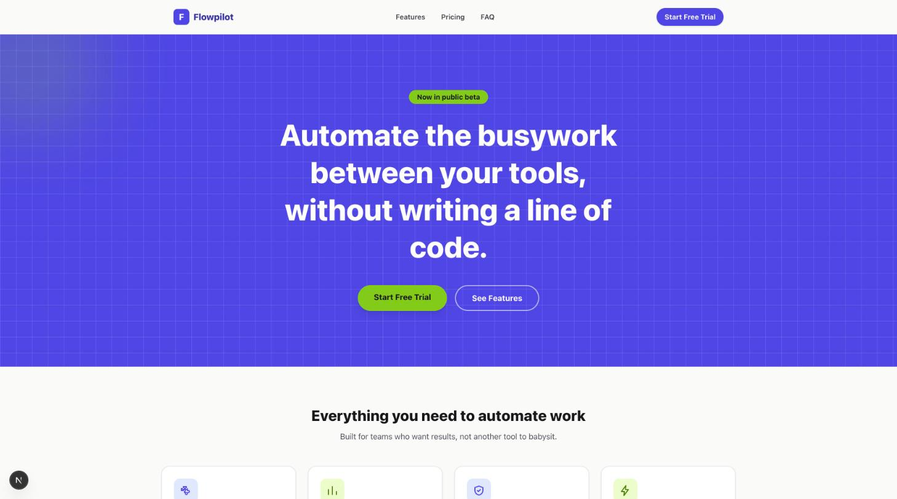

# SaaS Landing Template

White-label landing page template for small startups/SaaS products. Built with Next.js,
TypeScript, and Tailwind CSS. Demo content imagines a fictional workflow automation product
called Flowpilot.



## Structure

- `app/` - routes, including `/api/waitlist`
- `components/` - section components: Nav, Footer, Hero, FeatureGrid, PricingTable,
  FAQAccordion, WaitlistForm
- `lib/sanity.ts` - Sanity client (read) and write client (waitlist signups)

## Content

Content (site settings, features, pricing plans, FAQ) is fetched live from Sanity. See
`sanity/README.md` for how to deploy a Studio to edit it yourself.

## Development

```bash
pnpm install
pnpm dev
```

## Waitlist form

Posts to `/api/waitlist`, which writes a `waitlistSignup` document directly to Sanity using a
write-enabled API token. Requires `SANITY_API_WRITE_TOKEN` to be set in the environment; without
it, submissions are only logged to the server console (useful for local development).

## Docker

```bash
docker build -t saas-landing-template .
docker run -p 3000:3000 saas-landing-template
```

## Re-skinning for a new client

1. Edit `app/globals.css` CSS variables (`--color-primary`, `--color-accent`, etc.) for a new
   brand palette.
2. Edit content in Sanity Studio (product name, tagline, features, pricing, FAQ).
3. Swap `public/` images and the favicon.
